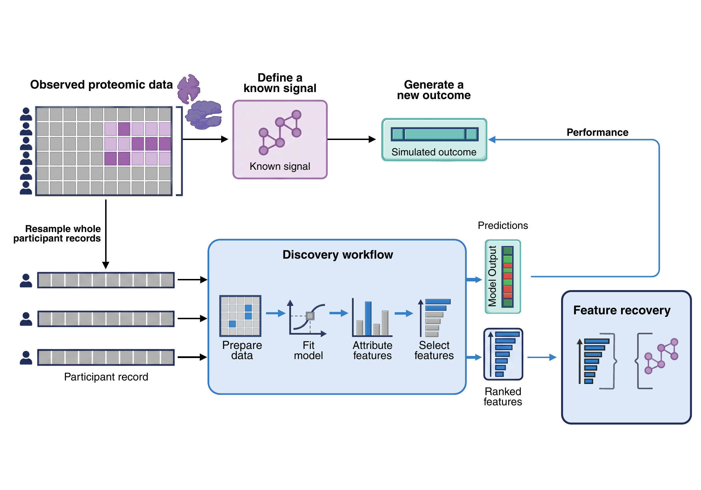

# PyPlasmode

PyPlasmode tests prediction and feature selection against a known signal. It combines your
feature data with simulated outcomes, so you can measure both how accurately a model predicts
and how well it identifies the features used to generate those outcomes.

Built for biomarker benchmarking, the library works with numeric tabular data more generally.
Its inputs are a matrix of observations and named features, not a particular assay or dataset.
A plasmode uses observed measurements to retain realistic feature relationships while you
control the outcome-generating mechanism. Synthetic matrices work too, as in the examples below.

Use it with your existing modelling workflow: generate a dataset, fit and tune your models,
then evaluate their predictions, feature rankings or selected panels.

[](https://bradsegal.github.io/PyPlasmode/methods/)

The same generated dataset supports two comparisons: predictions against outcomes, and
selected features against the signal that generated them.

Explore the [visual gallery](https://bradsegal.github.io/PyPlasmode/gallery/) for signal patterns, correlated-feature recovery
and the five outcome families.

The [feature-selection tutorial](https://bradsegal.github.io/PyPlasmode/tutorial/) follows a complete example from correlated
measurements through model fitting, attribution and recovery above chance.

## Installation

Requires Python 3.12-3.15. Install PyPlasmode 1.2.0 from [PyPI](https://pypi.org/project/pyplasmode/):

```bash
python -m pip install pyplasmode
```

The runtime dependencies are NumPy, SciPy and scikit-learn. To include the
reference validation and survival examples:

```bash
python -m pip install "pyplasmode[validation]"
```

## Ten-minute example

```python
import numpy as np
from sklearn.linear_model import LogisticRegression
import pyplasmode as ppm

rng = np.random.default_rng(1)
population = ppm.Population(
    rng.normal(size=(2_000, 100)),
    tuple(f"feature_{index}" for index in range(100)),
)

partition = ppm.partition_population(
    population,
    training_fraction=0.6,
    validation_fraction=0.2,
    seed=7,
)
samples = ppm.generate_partitioned(
    partition,
    truth=ppm.SparseTruth(features=("feature_3", "feature_17", "feature_42")),
    outcome=ppm.BinaryOutcome(probability=0.15, odds_ratio=2.0),
    sample_sizes=ppm.PartitionSampleSizes(1_200, 400, 400),
    sampling_method="without_replacement",
    seed=42,
)

train, test = samples.training, samples.evaluation
model = LogisticRegression(max_iter=1_000).fit(train.X, train.outcome.values)
ranking = tuple(train.feature_ids[index] for index in np.argsort(-np.abs(model.coef_[0])))

recovery = ppm.evaluate_ranking(ranking, train.truth, depths=(10, 20, 50))
prediction = ppm.evaluate_prediction(
    test.outcome.values,
    model.predict_proba(test.X)[:, 1],
    metric="roc_auc",
)
print(recovery.at_depth[0].recall)
print(prediction.value)
```

Recall measures how many of the three generating features appear in the model's top ten;
AUC measures prediction on held-out observations. Repeat the comparison with different seeds
to estimate average performance and its Monte Carlo uncertainty. In 1.2.0,
`compare_paired_replicates` aligns procedures by world identity before computing
paired effects and explicitly counts failed or unmatched pairs. See
[paired evaluation](https://bradsegal.github.io/PyPlasmode/evaluation/#paired-procedure-comparisons).

Source rows are split before resampling, keeping training, validation and test
rows separate. This example uses a fixed model; the validation sample is available for
hyperparameter tuning. See [Methods](https://bradsegal.github.io/PyPlasmode/methods/) for the generation process.

## What can be varied

- **Signal:** null, sparse features, correlated groups, distributed modules, pairwise
  interactions or a custom function.
- **Outcome:** binary probability, continuous mean and spread, count rate, ordinal category
  probabilities or cumulative event risks at native-time horizons.
- **Evaluation:** feature and group recovery, weighted-module and graph-region coverage,
  signal reconstruction, prediction accuracy, panel performance and ranking stability.
  Additional functions handle tied scores, incomplete selections and matched chance references.

Start with [Methods](https://bradsegal.github.io/PyPlasmode/methods/), then choose a [signal](https://bradsegal.github.io/PyPlasmode/truths/) and
[outcome](https://bradsegal.github.io/PyPlasmode/outcomes/). The [evaluation guide](https://bradsegal.github.io/PyPlasmode/evaluation/) defines each result.
The [validation example](https://bradsegal.github.io/PyPlasmode/validation/) checks the generators and recovery metrics against
known values and reference estimators.

The executable [quickstart](https://github.com/BradSegal/PyPlasmode/blob/main/examples/quickstart.py),
[survival example](https://github.com/BradSegal/PyPlasmode/blob/main/examples/survival.py)
and [custom signal](https://github.com/BradSegal/PyPlasmode/blob/main/examples/custom_signal.py)
use synthetic inputs. The [documentation](https://bradsegal.github.io/PyPlasmode/)
includes the generation methods, evaluation definitions and API reference.

## Working with empirical data

Resampling preserves the source data's feature relationships and missingness patterns.
It can reproduce individual records, so generated datasets require the same privacy protections
as their source. See [Data handling](https://bradsegal.github.io/PyPlasmode/privacy-and-limitations/).

## Licence

PyPlasmode uses the [BSD 3-Clause License](https://github.com/BradSegal/PyPlasmode/blob/main/LICENSE).

## New in 1.2.0

Version 1.2.0 extends generation and evaluation. `pyplasmode.metrics` adds chance-corrected
selection stability, tie-aware RBO, consensus ranks, censored cumulative/dynamic
AUROC, paired participant bootstrap differences and discrimination gaps. Binary
and survival specifications accept `target_auc` and report the solved effect
and expected oracle AUROC. See [metrics](https://bradsegal.github.io/PyPlasmode/metrics/),
[calibration](https://bradsegal.github.io/PyPlasmode/calibration/) and the [worked example](https://github.com/BradSegal/PyPlasmode/blob/main/examples/metrics_calibration.py).

The [synthetic benchmark](https://bradsegal.github.io/PyPlasmode/benchmark-demo/) fits Cox, ridge and XGBoost
across three signal mechanisms and three target oracle AUROCs, then compares
held-out AUROC with chance-adjusted top-20 recovery. Install the optional
`benchmark` extra to run `python examples/benchmark_recovery_demo.py`.
Install it with `python -m pip install "pyplasmode[benchmark]"`.
