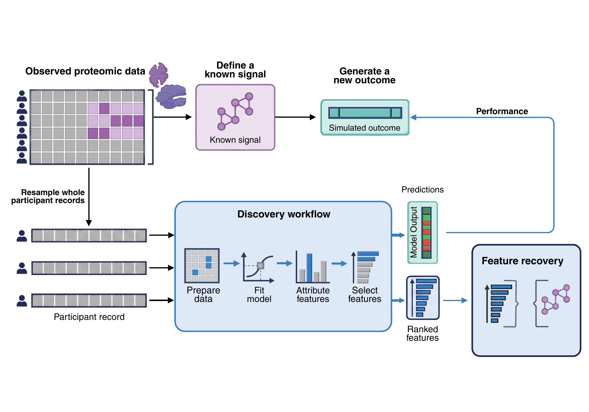

# PyPlasmode

[](https://doi.org/10.5281/zenodo.24518248)

A model can predict an outcome well while ranking the wrong features first, and on real data you
usually cannot tell, because the features that generated the outcome are unknown. PyPlasmode keeps
your feature data and simulates the outcome from features you choose. You can then measure how well
a model predicts the outcome and how many of the generating features it identifies.

Measured features with a simulated outcome are called a *plasmode*. The features keep their
real correlations, which is what makes selecting the right ones hard. The library was built for
biomarker benchmarking and accepts any numeric matrix of observations and uniquely named
features, with missing values as NaN. It
does not fit models: you fit them with your own tools and hand back their predictions,
rankings or selected panels.

[](https://bradsegal.github.io/PyPlasmode/methods/)

Start with the [feature-selection tutorial](https://bradsegal.github.io/PyPlasmode/tutorial/)
or the [visual gallery](https://bradsegal.github.io/PyPlasmode/gallery/).

## Installation

Requires Python 3.12-3.15. Install from [PyPI](https://pypi.org/project/pyplasmode/):

```bash
python -m pip install pyplasmode
```

The runtime dependencies are NumPy, SciPy and scikit-learn. The validation and survival
examples fit models from other libraries; to run them, install the optional extra:

```bash
python -m pip install "pyplasmode[validation]"
```

## Ten-minute example

Fit a classifier on simulated training outcomes, then check whether it predicts held-out
outcomes and ranks the known generating features first.

```python
import numpy as np
from sklearn.linear_model import LogisticRegression
import pyplasmode as ppm

rng = np.random.default_rng(1)
population = ppm.Population(
    rng.normal(size=(2_000, 100)),
    tuple(f"feature_{index}" for index in range(100)),
)

partition = ppm.partition_population(
    population,
    training_fraction=0.6,
    validation_fraction=0.2,
    seed=7,
)
samples = ppm.generate_partitioned(
    partition,
    truth=ppm.SparseTruth(features=("feature_3", "feature_17", "feature_42")),
    outcome=ppm.BinaryOutcome(probability=0.15, odds_ratio=2.0),
    sample_sizes=ppm.PartitionSampleSizes(1_200, 400, 400),
    sampling_method="without_replacement",
    seed=42,
)

train, test = samples.training, samples.evaluation
model = LogisticRegression(max_iter=1_000).fit(train.X, train.outcome.values)
ranking = tuple(train.feature_ids[index] for index in np.argsort(-np.abs(model.coef_[0])))

recovery = ppm.evaluate_ranking(ranking, train.truth, depths=(10, 20, 50))
prediction = ppm.evaluate_prediction(
    test.outcome.values,
    model.predict_proba(test.X)[:, 1],
    metric="roc_auc",
)
print(recovery.at_depth[0].recall)
print(round(prediction.value, 3))
# 1.0
# 0.626
```

The rows are split 60:20:20 into training, validation and test pools before sampling, so no row a
model is fitted on is also used to judge it. Three of the 100 features generate a binary outcome
that 15% of rows have on average, with odds that double for each standard deviation of the
generating score (the number computed for each row from the generating features).

The model ranks features by the size of its coefficients. The first number is the recovery
(`recall` in the API): the fraction of the three generating features in the model's top ten.
The second is the AUC (area under the ROC curve) on the test sample. The example fits with
fixed settings; to tune them, use the validation sample, so that the test sample still judges
a model it has not shaped. One simulated
dataset gives one draw of each result, so repeat with different seeds to estimate average
performance and its uncertainty.
[Paired evaluation](https://bradsegal.github.io/PyPlasmode/evaluation/#paired-procedure-comparisons)
compares two procedures across such repeats.

## What can be varied

Vary the signal, the outcome and the evaluation to match the conditions your method will face.

- **Signal:** a null, sparse, correlated, distributed or interaction structure, or a custom
  function.
- **Outcome:** binary probability, continuous mean and spread, count rate, ordinal category
  probabilities or cumulative event risks at chosen times. For binary and time-to-event outcomes,
  set a target AUC of the generating score in place of an odds or hazard ratio
  ([calibration](https://bradsegal.github.io/PyPlasmode/calibration/)).
- **Evaluation:** prediction accuracy, feature and group recovery, reconstruction of the
  generating score and stability across refits. Recovery can be compared with what random
  selection would achieve (recovery above chance), including when importance scores tie.

[Methods](https://bradsegal.github.io/PyPlasmode/methods/) describes how datasets are generated.
See also the [signal](https://bradsegal.github.io/PyPlasmode/truths/),
[outcome](https://bradsegal.github.io/PyPlasmode/outcomes/) and
[evaluation](https://bradsegal.github.io/PyPlasmode/evaluation/) guides, the
[validation example](https://bradsegal.github.io/PyPlasmode/validation/) and the
[API reference](https://bradsegal.github.io/PyPlasmode/api/). The
[synthetic benchmark](https://bradsegal.github.io/PyPlasmode/benchmark-demo/) compares held-out
AUC with top-20 recovery above chance for Cox, ridge and XGBoost.

## Using it with a coding agent

Use [`skills/pyplasmode`](https://github.com/BradSegal/PyPlasmode/tree/main/skills/pyplasmode) to
give a coding agent the simulation workflow, design choices and common pitfalls. See [Coding
agents](https://bradsegal.github.io/PyPlasmode/agents/).

## Working with empirical data

Resampling draws whole rows, so each generated row keeps its source row's measurements and missing
values, and correlations and missingness rates vary only by sampling. It can reproduce individual
records, so generated datasets require the same privacy protections as their source. See [Data
handling](https://bradsegal.github.io/PyPlasmode/privacy-and-limitations/).

## Citing

Each release is archived on Zenodo. Cite the version you used; version 1.2.1 is
[doi:10.5281/zenodo.24518249](https://doi.org/10.5281/zenodo.24518249). The DOI
[10.5281/zenodo.24518248](https://doi.org/10.5281/zenodo.24518248) always resolves to the latest
release. [`CITATION.cff`](https://github.com/BradSegal/PyPlasmode/blob/main/CITATION.cff) lists the
authors.

## Licence

PyPlasmode uses the [BSD 3-Clause
License](https://github.com/BradSegal/PyPlasmode/blob/main/LICENSE).
