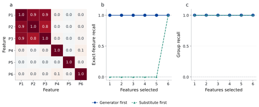
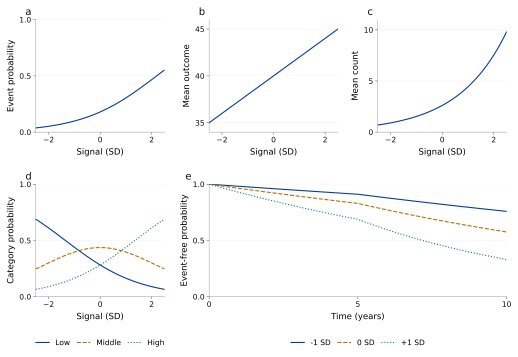

# Visual gallery

Three choices shape a feature-selection benchmark: how the generating features combine into a
signal, what counts as finding them when they have correlates, and what kind of outcome is
simulated. Each figure below varies one of these on synthetic inputs, so you can see its effect
before you set up your own study.

## Different signals, the same features

A method that fits additive effects can find a feature whose effect adds to the others and
still miss one that matters only in combination. To test whether your method captures the
relationships you expect in your data, give it signals of different structure built from the
same features.


Each panel computes the generating score, the number calculated for each row from the
generating features, over a grid of values of two features, P1 and P2. Colour and labelled
contours show the score after standardisation:

- **a**, no signal: the score is zero everywhere.
- **b**, P1 alone: the score changes only along P1.
- **c**, the sum of P1 and P2: the score changes with both.
- **d**, their product: the score rises where both are high or both are low, so neither feature
  predicts the outcome alone.
- **e**, a joint threshold: the score takes one value where both features are positive and
  another elsewhere, an abrupt rather than gradual change.
- **f**, the custom function `tanh(P1) + 0.5*tanh(P2)`: the score levels off at extreme values,
  and P1 counts twice as much as P2.

[Generating signals](truths.md) describes each structure and its settings.

[PDF](assets/patterns/signal-shapes.pdf) | [SVG](assets/patterns/signal-shapes.svg) |
[Source data](assets/patterns/signal-shapes.csv)

## Finding a feature or finding its group

When the generating feature has strong correlates, a model can rank a correlate first and
predict almost as well. Whether that counts as a success decides which recovery you measure.



**a**, Pearson correlations among six features in 1,000 synthetic observations. P1 generates
the outcome. P2 and P3 are its correlates, each correlated 0.9 with P1, and the three form one
group. P4 to P6 are unrelated. **b**, recovery of the generating feature and **c**, recovery of
the group, at each ranking depth, for two orders:

- **Generator first:** P1, P2, P3, P4, P5, P6.
- **Substitute first:** P2, P4, P5, P6, P3, P1, which puts a correlate first and P1 last.

Both orders find the group at the first rank. Only the first finds P1 there; the second finds
it at rank six. If a correlate is as useful to you as the generating feature, for example
because any member of the group would serve as a marker, measure group recovery with
`evaluate_groups`. If you need the generating feature itself, measure exact recovery with
`evaluate_ranking`.

[PDF](assets/patterns/correlated-recovery.pdf) | [SVG](assets/patterns/correlated-recovery.svg) |
[Correlations](assets/patterns/feature-correlations.csv) |
[Recovery data](assets/patterns/correlated-recovery.csv)

## Outcome families

The same generating score can produce a binary, continuous, count, ordinal or time-to-event
outcome. You specify each in the units you would report, such as an event probability or a
mean, and PyPlasmode solves for the model parameters that produce them (calibration).



Each curve shows how the outcome depends on the generating score after calibration on 2,000
synthetic observations, with the settings in the table:

- **a**, the probability of a binary event;
- **b**, the mean of a continuous outcome;
- **c**, the expected count;
- **d**, the probability of each of three ordered categories;
- **e**, the probability of remaining event-free over time, at generating scores one standard
  deviation (SD) below the mean, at the mean and one SD above. These curves are before
  censoring.

| Outcome | Example settings |
| --- | --- |
| Binary | Marginal probability 0.20; odds ratio 2 per SD of the generating score |
| Continuous | Mean 40; standard deviation 5; effect 2 outcome units per SD of the generating score |
| Count | Rate 3 per unit exposure; rate ratio 1.7; conditional variance-to-mean ratio 2 |
| Ordinal | Category probabilities 0.30, 0.40 and 0.30; common odds ratio 2 |
| Survival | Cumulative event risks 0.20 at 5 years and 0.45 at 10 years; hazard ratio 2 |

The [outcome guide](outcomes.md) explains each family and its calibration.

[PDF](assets/patterns/outcome-families.pdf) | [SVG](assets/patterns/outcome-families.svg) |
[Source data](assets/patterns/outcome-families.csv) |
[Calibrated parameters](assets/patterns/outcome-calibration.json)

## Generate the source tables

To redraw the figures with other signals or outcome settings, regenerate their data tables.
Install PyPlasmode from [PyPI](https://pypi.org/project/pyplasmode/), download the
[gallery example](https://github.com/BradSegal/PyPlasmode/blob/main/examples/pattern_gallery.py)
and run it:

```bash
python -m pip install pyplasmode
python pattern_gallery.py --output gallery-data
```

It writes the CSV tables and the calibrated parameters linked above to `gallery-data`. Edit the
signal and outcome settings in the script, run it again and plot the new tables with your own
plotting tools.
