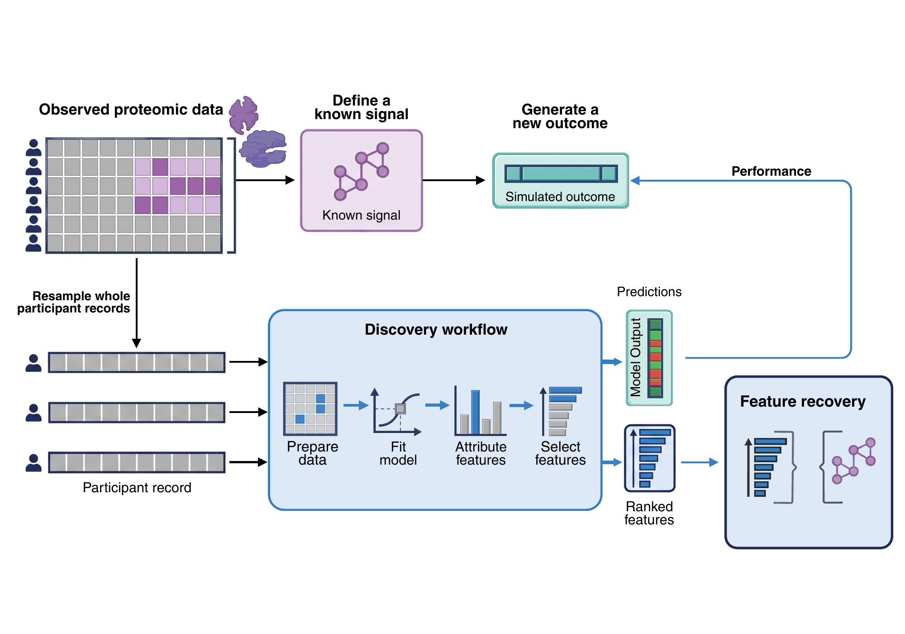

# Methods

## Generation process

A plasmode combines empirical feature data with outcomes generated from a known signal.
This lets you measure whether a method predicts the outcome and whether it recovers the
generating features, those used to generate that outcome.
[Gadbury et al.](references.md#plasmode-simulation)
illustrate the plasmode approach; [Schreck et al.](references.md#plasmode-simulation) describe
the combination of covariate resampling and outcome generation used here. For organising
the comparison, [Morris et al.](references.md#simulation-studies) introduce the ADEMP framework.



1. Sample complete rows from the source matrix. The default is sampling with replacement;
   use `sampling_method="without_replacement"` to include each source row at most once.
2. Construct and standardise the generating score on the sampled rows
   ([Signal construction](#signal-construction)). Returned `X` retains its missingness.
3. Calibrate the outcome model to the requested marginal targets and draw the outcomes.

Apply your usual preprocessing, model fitting, hyperparameter search and
explanation tools. PyPlasmode's evaluators take the resulting predictions and feature
selections.

## Correlation and missingness

Complete-row resampling samples from the joint empirical distribution, preserving relationships
between features and missingness patterns.

## Training, validation and test samples

Split your source rows with `partition_population` before drawing samples
with `generate_partitioned`. A source row belongs to only one pool: training
for fitting, validation for tuning or evaluation for testing. Sampling with
replacement can repeat a row within a pool. If people or clusters span several
rows, assign whole people or clusters to pools before generation.

Use `samples.evaluation_source_indices` to trace sampled evaluation rows back
to your original `Population`. Use `samples.evaluation.source_indices` to index
the evaluation pool itself. Training and validation have the same pair of fields.

```python
import numpy as np
import pyplasmode as ppm

population = ppm.Population(np.arange(12.0).reshape(-1, 1), ("A",))
partition = ppm.partition_population(
    population, training_fraction=0.5, validation_fraction=0.25, seed=0
)
samples = ppm.generate_partitioned(
    partition,
    truth=ppm.SparseTruth(features=("A",)),
    outcome=ppm.BinaryOutcome(probability=0.5, odds_ratio=2),
    sample_sizes=ppm.PartitionSampleSizes(training=6, validation=3, evaluation=3),
    sampling_method="without_replacement",
    seed=0,
)
local_row = samples.evaluation.source_indices[0]
print(local_row, partition.evaluation_source_indices[local_row])  # 1 8
assert partition.evaluation_source_indices[local_row] == samples.evaluation_source_indices[0]
```

`SparseTruth(count=...)` selects features using the training pool.
When `CorrelatedTruth` uses one generating feature per group and you omit
`sentinels`, PyPlasmode draws one member from each group and checks that it
has observed variation in the training pool. A constant or entirely missing
choice raises `ValueError`. All samples use the same chosen features.

PyPlasmode scales the generating score and calibrates the outcome across the training,
validation and evaluation rows together, so all three share one generating model. Changing
the evaluation rows therefore changes that model's scaling and baseline.

To compare populations, call `generate` once per population with the same effect, such as
the same odds ratio. Each call scales the score and calibrates the baseline on its own rows.
PyPlasmode has no option to hold the scaling and baseline fixed across populations: to do
that, compute the score and draw the outcomes in your own code.
See [AUC calibration](calibration.md#what-is-solved).

This is separate from your model's preprocessing, which you fit on the training sample only.

## Signal construction

The generating score (`truth.signal`) is the number computed for each row from
the generating features. For built-in signals, PyPlasmode fills missing values
with each feature's median, then centres and scales each feature to mean zero
and population standard deviation one. This leaves the returned `X` intact.
An explicitly chosen feature that is constant or entirely missing raises
`ValueError`. Automatic sparse selection skips such features.

For an additive signal, multiply each standardised feature value by its weight
and add the results. With weights 2 and −1, standardised values `A=1` and
`B=0.5` give a raw score of `2*1 - 0.5 = 1.5`.

A *sentinel* is the generating feature in its group. The other members are its
*correlates*. A *module* is a named `FeatureSet` whose members all contribute
to the generating score. See [Generating signals](truths.md).

| Signal structure | How to construct the score | What it tests |
| --- | --- | --- |
| Sparse | Add the weighted values of selected features. | Recovery of individual generating features |
| Correlated, sentinels | Add the weighted values of one generating feature per group. | Recovery of generating features and their correlates |
| Distributed | Add weighted values from all module members. | Recovery of a shared signal |
| Correlated, group means | Average standardised values within each group. Apply group weights and sum the means directly. | Recovery of group-level information |
| Interaction, product | Multiply two standardised values. | Dependence on their combination |
| Interaction, joint threshold | Give one if both standardised values are strictly greater than `threshold` (default `0.0`), otherwise zero. | A relationship requiring both conditions |

PyPlasmode centres and scales the completed score to mean zero and population
standard deviation one. A null score stays zero. An odds ratio of 2 doubles
the odds for a one-standard-deviation increase in the completed score.
See the [outcome guide](outcomes.md) for response models.

`SparseTruth(count=k)` shuffles candidates using the seed and adds features
whose absolute Pearson correlation with every feature already chosen is at
most `max_absolute_correlation` (default 0.7). If the search ends before
finding `k` features, it raises `ValueError`. Try a smaller count, a higher
limit or explicit feature names.

## Numerical calibration and random variation

Calibration matches the expected outcome across sampled rows to your target.
With `probability=0.15`, the mean event probability is 15%. The observed
fraction varies across draws. See the [calibration equations](outcomes.md#calibration-equations).
If the model cannot match your target, it raises `CalibrationError`. Check the
target and effect together. For example, reduce a risk ratio that pushes
some event probabilities above one.

After drawing outcomes, PyPlasmode checks the observed values against their
targets. For a probability `p` and `n` rows, the tolerance is the larger of
`6*sqrt(p*(1-p)/n)` and `6/n`. The latter allows a difference of six observations
even when the target probability is very small. Survival checks use latent
event risks and censoring risks at the specified times. Continuous means and
standard deviations and count rates use tolerances of six standard errors.

The checks run automatically. A draw outside tolerance raises
`RealizationError`. Count these failures when summarising your replicates.

```python
event_fractions = []
failure_count = 0
for seed in (1, 2, 3):
    try:
        replicate = ppm.generate(
            population,
            truth=ppm.NullTruth(),
            outcome=ppm.BinaryOutcome(probability=0.5, odds_ratio=1),
            sample_size=12,
            seed=seed,
        )
        event_fractions.append(replicate.outcome.values.mean())
    except ppm.RealizationError:
        failure_count += 1

summary = ppm.summarize_replicates(event_fractions, failure_count=failure_count)
print(summary.replicate_count, summary.failure_count)  # 3 0
```

## Discrimination and repeated selections

Set `target_auc` on a binary or time-to-event outcome to fix the AUC (area under the ROC
curve) of the generating score in place of an odds or hazard ratio
([AUC calibration](calibration.md)). `outcome.calibration.oracle_auc` is the AUC expected
before outcomes are drawn. The AUC realised in one draw differs from it by sampling variation,
most when events are few; measure it by scoring the generating score (`truth.signal`) against
the drawn outcomes.

For feature selections repeated across refits, `pyplasmode.metrics` provides
`selection_stability` and `consensus_ranking`; for AUC under censoring it provides
`cumulative_dynamic_auc` ([Metrics](metrics.md)).
