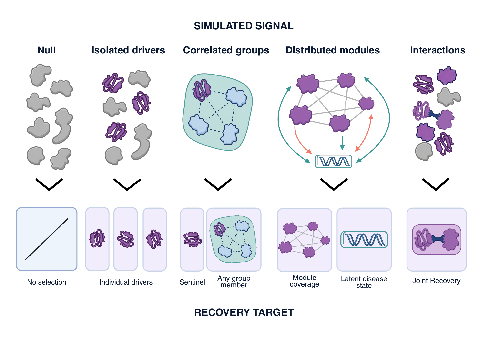

# Generating signals

The signal (`truth=` in code) answers the question "what should a method find?": one feature,
any member of a correlated group, or most of a pathway. It states which features generate the
outcome and in what structure. From it PyPlasmode computes the *generating score*
(`truth.signal`), one number per row, and the recovery targets a selection is scored against; the
[outcome model](outcomes.md) sets how strongly the score acts on the outcome.



In the diagram, "drivers" are generating features and "latent disease state" is the generating
score. The [tutorial](tutorial.md) compares sparse and correlated signals on the same measurements.

## Null

A null signal asks: how often does a procedure report features when there is nothing to find?

Write `NullTruth()`. The generating score is zero on every row, so no feature affects the outcome
and every selected feature is a false selection. Recovery cannot be computed, because there are no
generating features. Count instead how many features are selected, and how often the same ones
recur across repeated datasets: recurrence shows which features the procedure tends to pick when
there is nothing to find.

## Sparse

A sparse signal asks: does a method find the few individual features that generate the outcome,
rather than their correlates?

Write `SparseTruth(features=...)` to name the generating features, with optional non-zero
`weights` (default 1.0 each), or `SparseTruth(count=...)` to let PyPlasmode choose that many, no
two of which are near-copies ([Signal construction](methods.md#signal-construction)). Measure
recovery with `evaluate_ranking`.

```python
import numpy as np
import pyplasmode as ppm

a = np.array([-1, -1, 1, 1])
b = np.array([-1, 1, -1, 1])
names = ("A", "A_proxy", "B", "C")
population = ppm.Population(np.column_stack((a, a + b / 2, b, a * b)), names)
ranking = ("A_proxy", "A", "B", "C")

sparse = ppm.SparseTruth(features=("A", "B"))
sparse_truth = ppm.materialize_truth(sparse, population, seed=3)
print(ppm.evaluate_ranking(ranking, sparse_truth, depths=(2,)).at_depth[0].recall)
# 0.5

auto_sparse = ppm.SparseTruth(count=2, max_absolute_correlation=0.7)
print(ppm.materialize_truth(auto_sparse, population, seed=3).direct_features)
# ('C', 'B')
```

The examples on this page share a four-row population: every combination of A and B at −1 and 1, a
correlate `A_proxy` (A plus half of B, correlation 0.89 with A) and `C`, the product of A and B.
`ranking` stands in for a model's importance ranking, most important first. `materialize_truth`
computes the generating score and recovery targets without simulating outcomes. The top two
features hold A but not B, so recovery is 0.5 (the API calls it `recall`). The automatic choice
accepted C and B; it could never accept both A and A_proxy, because their correlation of 0.89
exceeds the limit.

## Correlated

A correlated signal asks: does a method find a generating feature, or settle for one of its
*correlates*, measured features strongly correlated with it?

Put each generating feature and its correlates in a named `FeatureSet`, pass them as
`feature_sets` to `generate`, and write `CorrelatedTruth(group_names=...)`, with one weight per
group (default 1.0). Groups must not share members, so that a selected feature counts towards one
group only. There are two forms:

- **One generating feature per group** (the default), the group's *sentinel* (`sentinels=` in
  code, drawn at random from each group if omitted); the other members only correlate with it.
  This asks whether a method picks the right member.
- **Group means** (`signal_form="group_means"`): every member contributes its standardised value
  to the group's average, so no member is the right one. This asks whether a method finds the
  group.

```python
correlated_sets = ppm.FeatureSets((ppm.FeatureSet("A_group", ("A", "A_proxy")),))
correlated = ppm.CorrelatedTruth(group_names=("A_group",), sentinels=("A",))
outcome = ppm.ContinuousOutcome(mean=0.0, standard_deviation=1.0, variance_explained=0.25)
correlated_sample = ppm.generate(
    population,
    truth=correlated,
    feature_sets=correlated_sets,
    outcome=outcome,
    sample_size=4,
    sampling_method="without_replacement",
    seed=3,
)
print(ppm.evaluate_groups(ranking, correlated_sample.truth, depths=(1,)).at_depth[0].group_recall)
print(ppm.evaluate_ranking(ranking, correlated_sample.truth, depths=(1,)).at_depth[0].recall)
# 1.0
# 0.0
```

Only the recovery targets matter here, so the outcome is arbitrary. Measure recovery with
`evaluate_groups` and, for the sentinel form, `evaluate_ranking`. A is the sentinel, but the
ranking puts A_proxy first, so at depth 1:

| Evaluator | Group found if the selection holds | Recovery |
| --- | --- | --- |
| `evaluate_groups` | any member | 1.0 |
| `evaluate_ranking` | the sentinel itself | 0.0 |

Reporting both shows how often a method finds the right group but the wrong member. Under group
means there is no sentinel; use `evaluate_groups`, or `evaluate_module` for the share of generating
weight the selection covers.

## Distributed

A distributed signal asks: how much of a signal does a selection capture when many features each
carry part of it, as the members of a biological pathway might?

Write `ModuleTruth(set_name=...)` and pass the named feature set in `feature_sets` to `generate`.
The score adds the standardised values of every member, each multiplied by its weight (default
1.0, in set order). Measure recovery with `evaluate_module`: the absolute weight of the selected
generating features divided by the total absolute weight, so a sign does not reduce credit.

```python
module_sets = ppm.FeatureSets((ppm.FeatureSet("pathway", ("A", "B", "C")),))
module = ppm.ModuleTruth(set_name="pathway", weights=(2.0, -1.0, 1.0))
module_sample = ppm.generate(
    population,
    truth=module,
    feature_sets=module_sets,
    outcome=outcome,
    sample_size=4,
    sampling_method="without_replacement",
    seed=3,
)
coverage = ppm.evaluate_module(ranking, module_sample.truth, depths=(2,))
print(coverage.at_depth[0].weighted_coverage)  # 0.5
```

The weights give A twice the weight of B or C, and make the score fall as B rises; B's −1 counts as
1 for coverage. The top two features are A_proxy and A, and A carries 2 of the 4 units of weight,
so coverage is 0.5.

Coverage gives A_proxy no credit, although it carries much of A's information. To measure how well
the selected features predict the generating score on held-out rows, whichever features they are,
use [`evaluate_signal_reconstruction`](evaluation.md#signal-reconstruction). `evaluate_ranking`
raises `ValueError` for this signal, because it has no individual generating features to find.

## Interaction

An interaction signal asks: does a method detect features that matter only in combination, such
as a risk that rises only when two measurements are both high? With the product form, each feature
on its own can show no association with the outcome, so a method that judges features one at a
time can miss both.

Write `InteractionTruth(features=("A", "B"))` and choose the `operation`:

- `"product"` (the default) multiplies the two standardised values, so the effect of one feature
  is proportional to the other's value, and reverses when the other is below its mean.
- `"threshold"` gives 1 when both standardised values are above `threshold` (in standard
  deviations, default 0.0) and 0 otherwise.

Measure recovery with `evaluate_fractional_recovery(..., estimand="interaction")`: the probability
that the selection contains both features.

```python
interaction = ppm.InteractionTruth(features=("A", "B"), operation="threshold", threshold=0.0)
interaction_truth = ppm.materialize_truth(interaction, population, seed=3)
selection = ppm.nomination_from_scores(names, (3, 0, 1, 1), depth=2)
interaction_recovery = ppm.evaluate_fractional_recovery(
    selection,
    interaction_truth,
    estimand="interaction",
)
print(interaction_recovery.value)  # 0.5
```

`nomination_from_scores` keeps the top two of the importance scores 3, 0, 1 and 1 for A, A_proxy,
B and C (the API calls a selection a *nomination*). A is selected, and B and C tie for second
place, so each is selected with probability 0.5. Only one of the two ways of breaking the tie
completes the pair, so recovery is 0.5.

A threshold that every row or no row clears on both features makes the score constant, and
generation raises `ValueError`, because a constant score cannot be standardised. Lower the
threshold if no row clears it; raise it if every row does.

## Custom signal

A custom signal asks a question the built-in structures cannot, such as whether a method copes
with a response that flattens at extreme measurements.

Wrap a function in `CustomTruth(function=...)`. PyPlasmode calls it with the sampled matrix
(read-only), its column names and a seeded NumPy random generator, and standardises the `signal`
of the `CustomSignal` it returns, one value per row. Recovery is measured against the targets you
declare in it: `direct_features` for
`evaluate_ranking`, `groups` for `evaluate_groups`, `weights` for `evaluate_module` and
`graph_region` for `evaluate_graph_region`.

```python
def saturation(X, feature_ids, rng):
    values = X[:, feature_ids.index("A")]
    return ppm.CustomSignal(signal=np.tanh(values), direct_features=("A",))


custom = ppm.CustomTruth(function=saturation)
custom_sample = ppm.generate(
    population,
    truth=custom,
    outcome=outcome,
    sample_size=4,
    sampling_method="without_replacement",
    seed=3,
)
print(ppm.evaluate_ranking(ranking, custom_sample.truth, depths=(2,)).at_depth[0].recall)
# 1.0
```

`saturation` makes A the only generating feature through `tanh`, which flattens beyond about two
units (here A is only −1 or 1, so the standardised score equals A). Declaring A in
`direct_features` lets `evaluate_ranking` score the ranking, and A is in the top two.

- **The score must be finite on every row and must vary**, or generation raises `ValueError`.
- **Fill missing values** before using a column that has any, because the matrix still holds them.
- **Draw any randomness from `rng` and return a new array on each call.** PyPlasmode calls the
  function twice with the same inputs and seed and raises `ValueError` if the scores or declared
  targets differ, because a dataset that cannot be regenerated from its seed cannot be reproduced;
  a reused array would let the second call overwrite the first result.
- **`generate_partitioned` does not accept a custom signal** and raises `ValueError`.
