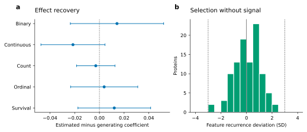

# Validation

A benchmark is only as trustworthy as its simulator. If the outcomes did not follow the settings you
asked for, or recovery were scored wrongly, every comparison built on them would mislead. The
validation example checks both on synthetic data where the right answers are known. To run it,
install the optional estimators from [PyPI](https://pypi.org/project/pyplasmode/), download the
[validation
script](https://github.com/BradSegal/PyPlasmode/blob/main/examples/validation_vignette.py) and run
it:

```bash
python -m pip install "pyplasmode[validation]"
python validation_vignette.py --output validation-output
```

It writes to `validation-output` CSV summaries, the figure below as PDF, SVG and PNG, and a JSON
report of the simulation design and its results, which it also prints. The JSON follows ADEMP (aims,
data-generating mechanisms, estimands, methods and performance measures), the reporting framework
for simulation studies described by [Morris et al.](references.md#simulation-studies).

## Reference run

The run targets three ways a simulator can fail: generating the wrong outcome, scoring a
ranking wrongly, and finding apparent signal where there is none.

1. **Create a population** of 20,000 rows and 100 independent Gaussian features. Because the
   features are independent and identically distributed, none has an advantage in being
   selected when the outcome is unrelated to them (step 6).
2. **Add a known effect.** One feature, standardised, generates a binary, a continuous, a
   count, an ordinal and a survival outcome, each with a stated effect size.
3. **Recover the effect with another implementation.** statsmodels fits a binomial, linear,
   Poisson, ordered-logistic and Cox model to the respective outcome. If PyPlasmode generates
   outcomes correctly, each fitted coefficient's 95% interval should contain the effect it was
   given, as it will in 95% of datasets.
4. **Repeat outcome generation** with 40 random seeds per outcome family, and compare the
   realised outcomes with the requested probabilities, rates and other targets in the outcome's
   own units.
5. **Check the recovery arithmetic.** Five features generate the signal. A ranking that puts
   them first should have a top-ten recovery of 1. Random rankings should average 10 of 100, a
   recovery of 0.1; the run draws 1,000 of them.
6. **Remove the association.** In 400 simulations, set the odds ratio to one, so the binary
   outcome is unrelated to every feature, and rank the features by their association with it.
   Each feature should then reach the top ten in 400 × 10/100 = 40 simulations on average,
   and no feature should stand out.



The points and 95% intervals show, for each outcome family, the statsmodels estimate minus the
effect PyPlasmode was given, from one simulated dataset each. Zero means exact agreement.
Ratio effects, such as odds ratios, are compared on the log scale. The histogram counts
features by how far the number of no-association simulations that put them in the top ten lies
from the expected 40, in standard deviations. The dashed lines at −3 and +3 correspond to
counts of 22 and 58.

The results:

- All five fitted intervals contained the effect PyPlasmode was given.
- All 40 replicates in each outcome family came within tolerance of their targets.
- The ranking with the generating features first had recovery 1. The 1,000 random rankings
  averaged 0.1018 against the expected 0.1, with a Monte Carlo standard error of 0.0042.
- Without an association, each feature reached the top ten between 23 and 54 times, all within
  three standard deviations of the expected 40.

Tables: [effect estimates](assets/validation/external-conformance.csv),
[outcome targets in native units](assets/validation/outcome-reproducibility.csv),
[ranking controls](assets/validation/truth-recovery.csv) and
[no-association counts](assets/validation/null-control.csv). The script holds the sample sizes
and seeds that produced them.

## Test suite

The reference run checks one configuration. The test suite checks the parts of the library
separately and at their edges, so that a change that breaks one is caught before release.
Tests compare each calculation with an independent reference, such as statsmodels Logit and
PHReg for generated effects and hypergeometric expectations for random recovery, and run the
full workflow for each outcome family, including null signals and missing data. The
[test suite](https://github.com/BradSegal/PyPlasmode/tree/main/tests) lists the references and
edge cases.

Two further sets of tests cover recovery above chance. Matched recovery tests compare the
analytic chance expectation with hypergeometric and sampled references. Outcome specificity
tests score one selection against its own signal and against other signals on different
features, the comparison that tests whether a selection recovers its own signal better than
signals it was not fitted to.

The `pyplasmode.metrics` tests compare tied selections, censored AUC and paired comparisons
with known results.

Target AUC calibration is tested in 12 binary and 36 survival settings; the [calibration
guide](calibration.md) lists their sample sizes and tolerances. The [metrics and calibration
example](https://github.com/BradSegal/PyPlasmode/blob/main/examples/metrics_calibration.py) runs
these functions together on synthetic scores.

To run the tests yourself, follow the
[development setup](https://github.com/BradSegal/PyPlasmode/blob/main/CONTRIBUTING.md) and run
`pytest`.
